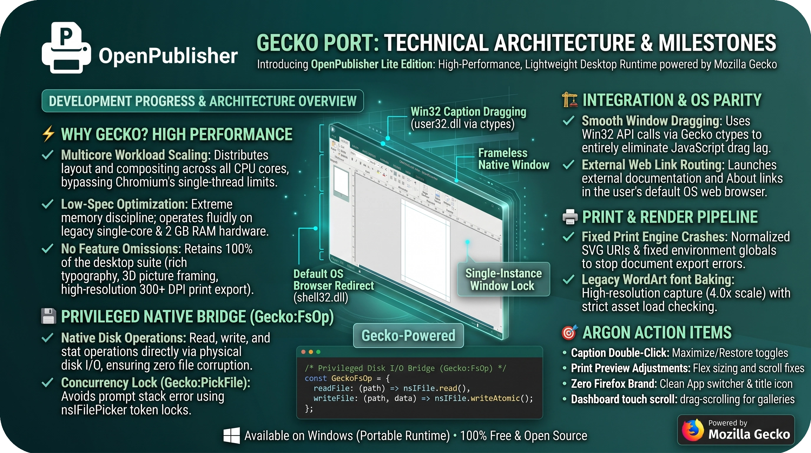

  

# OpenPublisher Gecko Port: Technical Architecture, Progress & Milestones

## 📌 Executive Overview & Core Mission
The **Gecko Port of OpenPublisher** is an active development initiative aimed at delivering **OpenPublisher Lite Edition**: a lightweight, native, and high-performance desktop runtime on Windows powered by the Mozilla Gecko engine, engineered to provide the complete OpenPublisher feature suite with zero compromises.

Spanning over a month of focused engineering (including two weeks of intensive Argon sessions and a week of Flash sessions alongside ongoing web app maintenance), the project transitions OpenPublisher from heavyweight multi-process desktop shells toward a dedicated, self-contained Gecko-embedded runtime. This document details the architectural motivations, hardware optimization benchmarks, core bridge implementations, and stability fixes accomplished to date.

---

## ⚡ Why Gecko: Performance Benchmarks, Multicore Scaling & Low-Spec Optimization

### Multicore Workload Scaling vs Chromium Single-Thread Bottlenecks
- **The Chromium Bottleneck**: In traditional Chromium-based desktop environments (such as Electron or NW.js), script execution, canvas DOM manipulation, and layout computation are frequently constrained to a single main thread, causing UI hitching, dropped frames during complex document updates, and CPU underutilization on multi-core architectures.
- **Gecko Parallelism**: Gecko's internal engine architecture distributes layout calculations, style recomputations, off-main-thread compositing (OMTC), and image decoding across all available physical and logical CPU cores.
- **Real-World Impact**: Canvas element manipulation, real-time image filtering, and multi-page layout processing scale smoothly across all cores, unlocking dramatic performance improvements, especially on older or budget machines.

### Low-Spec Hardware Viability (Single-Core & 2 GB RAM Systems)
- **Extreme Memory Discipline**: Standard Chromium runtimes demand substantial RAM overhead, frequently consuming 600 MB to 1+ GB of memory before opening a user document. In contrast, the Gecko runtime operates with a lean footprint, avoiding process bloat and aggressive memory consumption.
- **Fluid Legacy Machine Experience**: Empirical testing demonstrates that the Gecko build delivers a smooth, responsive desktop publishing experience even on constrained legacy hardware:
  - Legacy single-core processors
  - Systems with as little as 2 GB of total system memory
- **Zero Feature Omissions**: Unlike conventional "lite" applications that achieve efficiency by omitting capabilities, OpenPublisher Lite retains 100% of the full desktop suite: rich typography, vector and Legacy WordArt pipelines, authentic picture framing, page layout grids, SVG clipart libraries, proofing dictionaries, and high-resolution 300+ DPI print export engines.

---

## 🏗️ 1. Frameless Native Window Architecture & Startup Stability

### Single-Instance Window Management & Launch Race Elimination
- **Problem**: Opening OpenPublisher via file associations (`.opub`, `.json`) or clicking shortcuts in quick succession triggered multi-instance launch races, opening multiple separate Firefox browser windows and redundant chrome instances.
- **Solution**: Implemented single-instance window assignment and launch argument coordination directly within `firefox.cfg`. 
- **Result**: Command-line arguments and file associations are routed cleanly to the active runtime instance without spawning duplicate frames or unstyled browser chrome.

### Portable Architecture & Zero Hardcoded Paths
- **Implementation**: Fully recompiled `OpenPublisher.exe` from `OpenPublisher.cs` utilizing dynamic runtime path resolution.
- **Scope**: Replaced all machine-specific and static paths across:
  - `OpenPublisher.cs` (native launcher and process lifecycle manager)
  - `firefox.cfg` (privileged Gecko configuration and bootstrapping logic)
  - `gecko_nw_shim.js` (NW.js / Electron compatibility bridge)
  - User profile preferences and local storage caches
- **Result**: The application is fully portable and can execute from any directory, portable drive, or installation path without registry or path dependencies.

### Native Win32 Non-Client Caption Dragging
- **Implementation**: Integrated direct Win32 API calls (`ReleaseCapture` and `SendMessageW(hwnd, WM_NCLBUTTONDOWN, HTCAPTION, 0)`) via `user32.dll` through Gecko `ctypes`.
- **Functionality**: Binds native OS caption drag mechanics across the entire custom top bar, header controls, and unoccupied title bar surfaces.
- **Result**: Completely eliminates JavaScript `mousemove`/`screenX` lag, stutter, and window detachment during high-speed mouse dragging.

### Top-Bar Control Realignment & Coordinate Display
- **Layout Restoration**: Aligned top-bar window control buttons (Minimize, Maximize/Restore, Close) to match native desktop expectations (NW.js / Electron layout parity).
- **Coordinate Display**: Repositioned the live canvas coordinate readout (`#coord-display`) to prevent visual overlap with window controls, menus, or ribbon tabs.

### Child Window & Frameless Dialog Management
- **Implementation**: Configured privileged child window interceptors for dialog templates (`windows/*.html`).
- **Functionality**: Child dialogs dynamically inherit precise pixel dimensions, center-screen positioning, modal barriers, and always-on-top flags without exposing default Firefox browser toolbars, tabs, or address bars.

---

## 💾 2. Native File Dialogs & Privileged File System Bridge

### Concurrency-Suppressed File Picker Dialogs
- **Problem**: Asynchronous export and save invocations could queue multiple simultaneous file picker prompts, leading to repeated modal dialog popups.
- **Solution**: Added concurrency suppression and token locking to `Gecko:PickFile` using `Ci.nsIFilePicker`.
- **Result**: Clean single-invocation save, open, and export dialog flows across the application lifecycle.

### Real Disk File System Operations Bridge (`Gecko:FsOp`)
- **Implementation**: Established a high-performance privileged file system bridge in Gecko scope (`Gecko:FsOp`) interfacing directly with Windows disk I/O.
- **Supported Operations**:
  - `readFile` / `readFileSync`: Full binary and UTF-8 document ingestion.
  - `writeFile` / `writeFileSync`: Atomic write operations ensuring zero file corruption on system interruptions.
  - `appendFile`: High-throughput diagnostics and operation logging.
  - `readdir`: Local directory scanning for templates, fonts, and assets.
  - `stat`: File metadata, timestamp, and size inspections.
  - `unlink` & `rmdir`: Asset and temporary export cleanup.
  - `copyFile` & `rename`: Safe document backup and asset cloning.
  - `mkdir`: Recursive directory creation for project workspaces and cache trees.
- **Result**: Complete native support for opening, auto-saving, and packaging `.opub` and `.json` documents directly to physical storage.

---

## 🖨️ 3. Printing Engine & High-Resolution Vector/Raster Pipeline

### Resolution of Print Engine Initialization Error
- **Problem**: Triggering print output on pages containing Scrapbook images, Web Clipart, or uploaded framed images immediately crashed with an alert: `"Print Error - Failed to generate print file."`
- **Root Cause**: Identified an undefined variable error (`ReferenceError: activeEl is not defined`) inside `print-engine.js` caused by missing environment globals in the Gecko guest scope.
- **Solution**:
  - Initialized `window.activeEl = null` within the guest compatibility bridge.
  - Implemented `normalizeSvgDataUriForGecko` ensuring that all SVG data URIs passed to the rasterizer declare explicit pixel `width`, `height`, and `viewBox` attributes for Gecko `<canvas>` drawing contexts.
- **Result**: Flawless print document generation without crashes or missing graphical elements.

### High-Resolution Legacy WordArt Rendering & WebFont Synchronization
- **Problem**: Modern Beta WordArt printed reliably, but Legacy WordArt styles frequently rendered as blank, transparent rectangles (the "Flash of Invisible Text" issue).
- **Root Cause**: Gecko's isolated SVG `<foreignObject>` parser initialized and exported to raster surfaces before asynchronous Google WebFonts had fully decoded and applied to the DOM.
- **Solution**:
  - Implemented `captureFramePNG` utilizing privileged `ctx.drawWindow` at 4.0x scale with strict alpha-channel integrity verification.
  - Integrated `geckoBakeLegacyWordArt` into `firefox.cfg`, explicitly awaiting font readiness via `document.fonts.load()` and `document.fonts.ready` alongside image element decodes before passing nodes to the print pipeline.
- **Verification**: Verified end-to-end rendering on complex multi-layered documents combining Scrapbook items, transparent SVG cliparts, and both Legacy and Beta WordArt typography styles.

---

## 🌐 4. Knowledge Base & UI Isolation

### Knowledge Base Theme Scope Isolation
- **Problem**: Global desktop CSS theming (such as the default OpenPublisher green theme) bled into the embedded Knowledge Base modal (`kb.openpublisher.app`), causing color inversions, illegible text, and corrupted UI controls.
- **Solution**: Scoped application-level color styles and background theming to exclude the Knowledge Base frame hierarchy.
- **Result**: Preserves the native visual presentation, layout, and readability of the Knowledge Base while maintaining the chosen desktop theme for the main publisher workspace.

---

## 🔗 5. External Link Handling in OS Default Browser

### Native Win32 Shell Protocol Redirection
- **Problem**: Clicking hyperlinks in documentation, modals, or dialogs opened standard Firefox browser sessions inside the frameless Gecko wrapper, trapping the user in unnavigable browser frames that required `Alt+F4` to close.
- **Solution**:
  - Implemented `openExternalUrl` leveraging `shell32.dll`'s `ShellExecuteW` (`SW_SHOWNORMAL`) and `nsIExternalProtocolService`.
  - Added click and navigation interception hooks across:
    - Main editor workspace
    - NW.js / Gecko guest wrapper
    - Child dialogs (`windows/*.html`)
    - About dialog links (Facebook, GitHub, Patreon, PayPal)
    - External documentation and Knowledge Base links
    - Calls routed through `nw.Shell.openExternal`
- **Result**: All external web destinations launch instantly in the user's configured Windows default web browser (Chrome, Edge, Firefox, Brave, etc.), keeping the OpenPublisher desktop application clean, focused, and secure.

---

## 📊 Summary of Technical Components

| Component / Layer | Technology | Primary Role |
| :--- | :--- | :--- |
| **`OpenPublisher.exe`** | C# / .NET Win32 | Native portable launcher, process watchdog, path resolution |
| **`firefox.cfg`** | Gecko JavaScript (Privileged) | Engine configuration, single-instance lock, font baking, shell hooks |
| **`gecko_nw_shim.js`** | JavaScript Bridge | NW.js and Electron API compatibility translation layer |
| **`Gecko:FsOp`** | XPCOM / Privileged JS | Real physical disk read/write/stat operations |
| **`Gecko:PickFile`** | XPCOM (`nsIFilePicker`) | Native Windows file open and save dialogs with concurrency guard |
| **`user32.dll` (ctypes)** | Win32 API via Gecko ctypes | Native window dragging (`HTCAPTION`), window management |
| **`shell32.dll` (ctypes)**| Win32 API via Gecko ctypes | OS-level URL redirection via `ShellExecuteW` |
| **`print-engine.js`** | Gecko Rasterization | High-DPI canvas capture, SVG normalization, print spooling |

---

## 🎯 Next Steps & Milestones (Argon Action Items)

### 1. Window Ergonomics & Drag Zone Mechanics
- [ ] **Double-Click Caption to Maximize / Restore**:
  - Implement standard Win32 double-click detection on the custom top-bar drag zone.
  - Double-clicking empty areas of the title bar should toggle between maximized and restored window states.
- [ ] **Full-Window Drag Zone During Splash / Loading**:
  - Make the entire application window draggable while the loading splash screen is active (initial ~5 seconds of startup).
  - Transition drag mechanics back to the top-bar header once the main workspace has initialized.
- [ ] **Workspace Centering on Window Resize & Maximize**:
  - Resolve the viewport bug where resizing or maximizing the window causes the canvas paper to jump to the far-left edge of the screen, requiring manual horizontal scrolling.
  - Recalculate paper centering and scroll anchors dynamically during window resize events.

### 2. Print Preview Viewport & Sizing Corrections
- [ ] **Print Preview Layout & Scrollbar Remediation**:
  - Fix cropped content and large horizontal bottom scrollbars inside the Gecko print preview window.
  - Adjust preview iframe flex boundaries, overflow clipping, and canvas scaling to display the full sheet without unnecessary scrollbars.

### 3. Application Branding & Icon Uniformity
- [ ] **Eliminate Remaining Firefox Runtime Icons**:
  - Investigate and replace remaining Mozilla/Firefox branding icons displayed when the application is running (e.g. taskbar window badge, Alt+Tab app switcher, and window title icon).
  - Since `OpenPublisher.exe` resources already show the OpenPublisher icon in Resource Hacker, trace secondary runtime icon assets:
    - Check Gecko chrome icon paths (e.g. `chrome/icons/default/main-window.ico` and `browser/chrome/icons/default/default.ico`).
    - Inspect branding packages within `omni.ja`.
    - Verify Windows Application User Model ID (AUMID) assignment in the C# launcher to decouple the window from the default Firefox taskbar group.

### 4. Networking & Feature Parity
- [ ] **Broadcast to Classroom Service Wiring**:
  - Resolve the non-functional "Start Broadcast" button in the Classroom broadcasting tool.
  - Verify and bridge required WebSocket, WebRTC, or local network socket APIs missing from the Gecko guest environment.
- [ ] **First Run Wizard Trigger File Parity**:
  - Replicate the NW.js onboarding workflow: check for the presence of a specific marker file in the application directory on launch to trigger the First Run Wizard.
  - Automatically delete the marker file upon wizard completion so subsequent launches boot directly into the standard workspace.

### 5. Dashboard Touch / Kinetic Drag-to-Scroll
- [ ] **Template Gallery Mouse Drag-Scrolling vs Image Dragging**:
  - Fix template browsing on the dashboard screen: clicking and dragging should scroll through templates smoothly (like touch/kinetic panning).
  - Suppress native HTML5 image dragging (`ondragstart="return false"` or CSS `user-drag: none; pointer-events: none;` on preview images).
  - Implement a drag movement threshold (e.g. >5px) to prevent accidental template selection and loading upon mouse release after a scroll gesture.

### 6. Packaging & Performance Profiling
- [ ] Memory footprint optimization during high-DPI export batching.
- [ ] Accelerated hardware canvas rendering profiling across varied GPU configurations.
- [ ] Automated installer and portable package generation for OpenPublisher Lite testing builds.
- [ ] Extended unit test suite covering native file operations under restricted Windows permissions.
